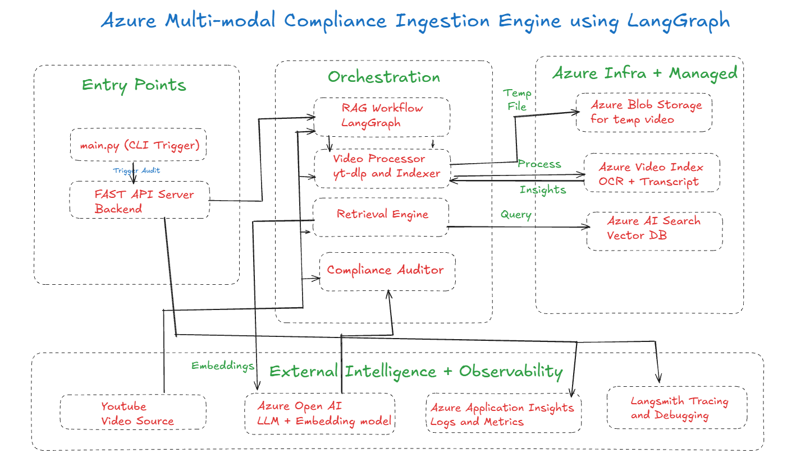

# Brand Guardian AI - Automated Video Compliance & Regulatory QA Pipeline

[](https://www.python.org/)
[](https://fastapi.tiangolo.com/)
[](https://aws.amazon.com/)
[](https://langchain-ai.github.io/langgraph/)
[](https://ai.google.dev/)

An enterprise-grade, agentic AI compliance auditor designed to automatically ingest marketing and social video content, extract multimodal signals (Speech-to-Text & On-Screen Visual OCR), query authoritative regulatory knowledge bases, and generate structured violation reports in real time.

---

## 🏛 Architecture Overview



```
[YouTube / Video Source]
         │
         ▼
[Video Ingestion & Download] (yt-dlp)
         │
         ▼
  [Amazon S3 Bucket]
    ├── Incoming Media Storage
    └── Knowledge Base Policies
         │
         ├─────────────────────────────────────────┐
         ▼                                         ▼
[Amazon Transcribe]                       [Amazon Rekognition]
 (Speech-to-Text Audio Stream)             (On-Screen Text / OCR)
         │                                         │
         └───────────────────┬─────────────────────┘
                             │
                             ▼
                   [LangGraph Controller]
                             │
                             ▼
         [Amazon Bedrock Knowledge Base] (RAG)
           - FTC Influencer Guidelines (PDF)
           - Platform Advertising Specs (PDF)
                             │
                             ▼
               [Google Gemini LLM Auditor]
           - Rule-based reasoning & validation
           - Severity classification (CRITICAL / WARNING)
                             │
                             ▼
           [Compliance Audit Report & API Output]
```

### Key Workflow Steps
1. **Ingestion & Processing (`IndexerNode`)**:
   - Downloads source video and streams to **Amazon S3**.
   - Initiates an **Amazon Transcribe** job to produce high-fidelity speech-to-text transcripts.
   - Initiates an **Amazon Rekognition** job to detect on-screen fine print, disclaimers, and overlays (OCR).
2. **Knowledge Base Retrieval (`AuditorNode`)**:
   - Retrieves authoritative regulatory clauses from **Amazon Bedrock Knowledge Base** (`AmazonKnowledgeBasesRetriever`).
3. **Reasoning & Enforcement**:
   - Passes multimodal context and retrieved regulatory policies to **Google Gemini** for deterministic compliance auditing.
4. **Delivery**:
   - Structured JSON output returned via **FastAPI** (`POST /audit`), **CLI**, or **AWS Lambda**.

---

## 🚀 Getting Started

### 1. Prerequisites
- Python >= 3.12
- [uv](https://docs.astral.sh/uv/) package manager
- AWS Account with permissions for S3, Transcribe, Rekognition, and Bedrock
- Google Gemini API key

### 2. Environment Configuration
Create a `.env` file in the root directory (based on `.env.example`):

```bash
# AWS Credentials
AWS_ACCESS_KEY_ID="your-access-key-id"
AWS_SECRET_ACCESS_KEY="your-secret-access-key"
AWS_REGION="us-east-1"

# AWS S3 & Bedrock
AWS_S3_BUCKET="your-s3-bucket-name"
AWS_BEDROCK_KNOWLEDGE_BASE_ID="your-bedrock-kb-id"

# Google Gemini (LLM Auditor)
GOOGLE_API_KEY="your-gemini-api-key"
GOOGLE_MODEL="gemini-2.0-flash"

# Optional: LangSmith Tracing
LANGCHAIN_TRACING_V2=true
LANGCHAIN_API_KEY="your-langchain-api-key"
LANGCHAIN_PROJECT="brand-guardian-compliance"
```

### 3. Installation
Install all project dependencies with `uv`:
```bash
uv sync
```

### 4. Indexing Policies to AWS Bedrock
Upload rulebooks and regulatory guidelines from `backend/data/` to AWS S3 and trigger Bedrock Knowledge Base sync:
```bash
uv run python backend/scripts/index_documents.py
```

### 5. Running the CLI Simulation
Run a test audit on a sample video URL:
```bash
uv run python main.py
```

### 6. Starting the FastAPI Service
Launch the REST API server:
```bash
uv run uvicorn backend.src.api.server:app --reload --port 8000
```
Interactive Swagger UI documentation is available at: `http://localhost:8000/docs`

---

## 📡 API Reference

### Health Check
```http
GET /health
```
**Response:**
```json
{
  "status": "healthy",
  "service": "Brand Guardian AI"
}
```

### Trigger Compliance Audit
```http
POST /audit
Content-Type: application/json

{
  "video_url": "https://youtu.be/dT7S75eYhcQ"
}
```

**Response Example:**
```json
{
  "session_id": "b3e944b2-03d8-4f81-a9f8-18e59074d081",
  "video_id": "vid_b3e944b2",
  "status": "FAIL",
  "final_report": "Detected 1 critical violation regarding unsubstantiated guarantees and missing FTC disclosures.",
  "compliance_results": [
    {
      "category": "Misleading Claims",
      "severity": "CRITICAL",
      "description": "Absolute performance guarantee stated without qualifying clinical or empirical disclaimer."
    }
  ]
}
```

---

## ☁️ Serverless AWS Lambda Deployment
The `aws_lambda/lambda_function.py` handler supports execution triggered by:
- **API Gateway** HTTP requests
- **S3 Bucket Notifications** (`s3:ObjectCreated:*` to automatically audit videos as soon as they are uploaded).

---

## 🛡 License
Internal Enterprise Use - Confidential.
